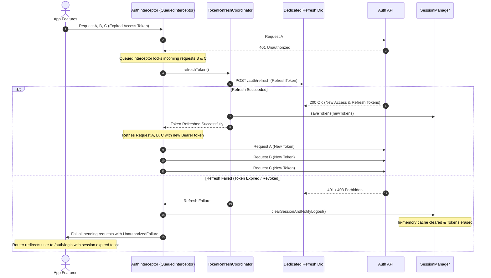

# ARCHITECTURE PROPOSAL & TECHNICAL SPECIFICATION

**Document ID:** SPEC-ARCH-001  
**Project:** Pickleball Multi-Role Platform (Frontend)  
**Version:** 1.3.0  
**Date:** 03 November 2026  
**Status:** Completed (Phase 0 — P0-01 through P0-06 Complete, Pending Final User Sign-Off)  
**Source Baseline:** Frontend FSD v1.0, Master PRD v1.0, 12 Role PRDs  
**Environment Baseline:** Flutter 3.47.6 (Channel Stable) • Dart 3.13.5  

---

## 1. Executive Summary & Architectural Principles

1. **Single Application, Multi-Role Architecture:**  
   One Flutter codebase serving all 12 platform roles. A single authenticated identity may hold multiple active roles. Role switching dynamically updates the `ActiveRoleContext`, navigation shell, and capability-aware views without re-authentication.

2. **Clean Architecture with Feature-First Modular Structure:**  
   Code is partitioned by feature/role boundary first, then layered internally into:
   - **Presentation Layer:** Widgets, Screens/Pages, Bloc/Cubit, UI State, and Form Controllers.
   - **Domain Layer:** Pure Dart entities, value objects, failure classes, and abstract repository contracts. Free of Flutter and network framework imports. Orchestration usecases are introduced only for multi-step domain workflows; simple CRUD operations delegate directly from Bloc/Cubit to repository interfaces.
   - **Data Layer:** DTOs (Data Transfer Objects), JSON mappers, Data Sources (`RemoteDataSource`, `MockDataSource`), and concrete Repository implementations.
   - **Core Layer:** Cross-cutting concerns (Network client, Auth & Token session, Route guards, Active Role context, Design tokens, Base failure types, Utility extensions).

3. **Backend Authoritative Security:**  
   Client-side route guards and UI visibility toggles exist solely for user experience. Backend authorization is the sole source of security. Any `401 Unauthorized` or `403 Forbidden` response is gracefully handled without leaking sensitive records.

4. **Production Mock Isolation, Verified DI & Build Testing:**  
   Mock data sources and simulation controls are never assumed to be disabled by `kReleaseMode` alone. Mock isolation is enforced through:
   - Strict compile-time gating (`!kReleaseMode && bool.fromEnvironment('USE_MOCKS')`).
   - Separate dependency injection composition roots (`_registerRemoteRepositories` vs `_registerMockRepositories`).
   - Release-build verification tests that inspect DI registrations to guarantee zero mock instances in production artifacts.

5. **Lean Dependencies (Zero Code-Gen for Models):**  
   Keep dependencies minimal and verified against Flutter 3.47.6 / Dart 3.13.5. No heavy code generation (`freezed`, `json_serializable`, `build_runner`). Utilize modern Dart 3 sealed classes, records, and `equatable`.

---

## 2. Complete Flutter Folder Tree

```text
lib/
│
├── app/                                                # Application bootstrap & assembly
│   ├── app.dart                                        # MaterialApp.router with global theme & providers
│   ├── app_bloc_observer.dart                          # Global state transitions & sanitized error logging
│   └── service_locator.dart                            # Central GetIt dependency injection registry
│
├── core/                                               # Cross-cutting platform infrastructure
│   ├── access/                                         # Dynamic role context & authorization logic
│   │   ├── active_role_context.dart                    # Holds active RoleType, orgId, orgName, capabilities
│   │   ├── app_capability.dart                         # Enum of granular staff permissions (e.g., editMatchScore)
│   │   └── role_permission_evaluator.dart              # UI helper to evaluate role & capability visibility
│   ├── auth/                                           # Authentication & session token management
│   │   ├── session_manager.dart                        # Auth lifecycle, user identity, logout cleanups
│   │   ├── token_storage.dart                          # Secure persistence contract for JWT tokens
│   │   └── token_refresh_coordinator.dart              # Safe concurrent token refresh coordinator
│   ├── cache/                                          # Comprehensive multi-tenant boundary isolation
│   │   ├── cache_registry.dart                         # Registry of all active feature in-memory caches
│   │   ├── clearable_cache.dart                        # Contract implemented by repositories with memory cache
│   │   ├── cancel_token_registry.dart                  # Cancels in-flight requests on role/org switch
│   │   └── scoped_storage_cleaner.dart                 # Cleans persisted org/role-scoped local data
│   ├── constants/                                      # Compile-time constants
│   │   ├── api_endpoints.dart                          # REST endpoint URLs and path templates
│   │   ├── app_constants.dart                          # Pagination limits, timeout limits, regex patterns
│   │   └── storage_keys.dart                           # Keys for secure storage and preferences
│   ├── design_system/                                  # Pure design tokens & theming
│   │   ├── app_colors.dart                             # Semantic color palette (primary, courtGreen, surface, etc.)
│   │   ├── app_spacing.dart                            # 4pt/8pt spacing scale, radius, and elevation tokens
│   │   ├── app_typography.dart                         # TextTheme definitions (headings, body, captions)
│   │   ├── app_theme.dart                              # Light and Dark ThemeData constructors
│   │   └── responsive_layout.dart                      # Breakpoint tokens (<600, 600-1024, >1024) & builder
│   ├── errors/                                         # Typed failure and exception hierarchy
│   │   ├── exceptions.dart                             # ServerException, CacheException, NetworkException
│   │   ├── failures.dart                               # Failure base class and specific typed subclasses
│   │   └── error_mapper.dart                           # Converts DioException into user-friendly Failure
│   ├── logging/                                        # Strict sensitive-data sanitizing logger
│   │   ├── app_logger.dart                             # Global logger respecting kReleaseMode
│   │   └── log_sanitizer.dart                          # Masks tokens, passwords, financial & KYC fields
│   ├── network/                                        # HTTP transport layer
│   │   ├── api_client.dart                             # Dio wrapper with standard timeout & retry configs
│   │   ├── auth_interceptor.dart                       # QueuedInterceptor handling Bearer & 401 refresh
│   │   ├── mock_network_harness.dart                   # Debug-only latency (400ms) & failure toggles
│   │   ├── pagination_params.dart                      # Standard page, limit, sort, and query parameters
│   │   └── result.dart                                 # Compile-safe Dart 3 sealed class Result<T>
│   ├── router/                                         # Declarative routing engine
│   │   ├── app_router.dart                             # GoRouter instance with reactive redirects & shells
│   │   ├── app_routes.dart                             # Standardized route path constants
│   │   └── route_guards.dart                           # Guard functions for auth, suspension, and role access
│   ├── utils/                                          # Pure helper utilities
│   │   ├── date_time_formatter.dart                    # Standardized date, time, and relative time formatters
│   │   ├── money_formatter.dart                        # Currency formatter (configurable INR/global formatting)
│   │   └── form_validators.dart                        # Mobile number, password, email, and required validators
│   └── widgets/                                        # Atomic design system widgets
│       ├── app_button.dart                             # Primary, secondary, outline, destructive, loading states
│       ├── app_text_field.dart                         # Text, phone, secure password with toggle, search
│       ├── app_card.dart                               # Standard card surface with unified borders & elevations
│       ├── app_dialog.dart                             # Action confirmations with consequences display
│       ├── app_chip.dart                               # Status chip (Active, Pending, Rejected, Draft)
│       └── state_views/                                # Global standard screen state widgets
│           ├── loading_view.dart                       # Skeleton loader / progress indicator
│           ├── empty_view.dart                         # Context-aware empty state with permitted action CTA
│           ├── error_view.dart                         # Human-readable error display with safe retry
│           ├── permission_denied_view.dart             # 403 Forbidden screen without leaking record details
│           └── account_suspended_view.dart             # Suspended account notice with support contact info
│
├── shared/                                             # Domain entities & widgets shared across multiple roles
│   ├── entities/                                       # Cross-cutting pure business objects
│   │   ├── user_profile.dart                           # Basic profile: id, name, mobile, email, avatar
│   │   ├── role_type.dart                              # Enum of all 12 platform roles
│   │   ├── address.dart                                # Geo/Postal address entity
│   │   └── money.dart                                  # Value object for currency & decimal amounts
│   └── widgets/                                        # Shared structural UI components
│       ├── app_context_bar.dart                        # Top app bar displaying active role & org badge
│       ├── app_navigation_shell.dart                   # Role-aware responsive drawer / bottom navigation bar
│       ├── permission_aware.dart                       # Visibility wrapper based on required AppCapability
│       └── notification_badge.dart                     # Real-time unread notification indicator
│
├── features/                                           # Feature modules (Identity, Shared & 12 Platform Roles)
│   │
│   ├── identity/                                       # Phase 1: Authentication & Account Lifecycle (/auth)
│   │   ├── presentation/
│   │   │   ├── bloc/                                   # AuthBloc (login, logout, session status)
│   │   │   ├── pages/                                  # WelcomePage, LoginPage, RegisterPage, ForgotPasswordPage
│   │   │   └── widgets/                                # MobileInputField, PasswordStrengthIndicator
│   │   ├── domain/
│   │   │   ├── entities/                               # AuthSession, UserCredentials, AccountStatus
│   │   │   ├── repositories/                           # AuthRepository (abstract interface)
│   │   │   └── usecases/                               # LoginUseCase, LogoutUseCase (orchestrating session & cache)
│   │   └── data/
│   │       ├── datasources/                            # AuthRemoteDataSource, AuthMockDataSource
│   │       ├── models/                                 # AuthSessionDto, LoginRequestDto
│   │       ├── mappers/                                # AuthSessionMapper
│   │       └── repositories/                           # MockAuthRepository, ApiAuthRepository
│   │
│   ├── role_selection/                                 # Phase 1: Role Context & Switcher (/role-selection)
│   │   ├── presentation/
│   │   │   ├── cubit/                                  # RoleContextCubit (active role, remembered role toggle)
│   │   │   ├── pages/                                  # RoleSelectionPage
│   │   │   └── widgets/                                # RoleCard, OrganizationSelectorTile
│   │   ├── domain/
│   │   │   ├── entities/                               # RoleAssignment, OrganizationProfile
│   │   │   ├── repositories/                           # RoleContextRepository (abstract interface)
│   │   │   └── usecases/                               # SwitchActiveRoleUseCase (orchestrates cache purge & context)
│   │   └── data/
│   │       ├── datasources/                            # RoleContextMockDataSource, RoleContextRemoteDataSource
│   │       ├── models/                                 # RoleAssignmentDto
│   │       ├── mappers/                                # RoleAssignmentMapper
│   │       └── repositories/                           # MockRoleContextRepository, ApiRoleContextRepository
│   │
│   ├── notifications/                                  # Phase 1: Notification Center (/notifications)
│   │   ├── presentation/
│   │   │   ├── cubit/                                  # NotificationsCubit (unread count, mark read, filter)
│   │   │   ├── pages/                                  # NotificationCenterPage, NotificationPreferencesPage
│   │   │   └── widgets/                                # NotificationTile, NotificationTypeFilter
│   │   ├── domain/
│   │   │   ├── entities/                               # AppNotification, NotificationType, NotificationPrefs
│   │   │   └── repositories/                           # NotificationRepository (abstract interface)
│   │   └── data/
│   │       ├── datasources/                            # NotificationMockDataSource, NotificationRemoteDataSource
│   │       ├── models/                                 # NotificationDto
│   │       ├── mappers/                                # NotificationMapper
│   │       └── repositories/                           # MockNotificationRepository, ApiNotificationRepository
│   │
│   ├── public_tournament/                              # Public Views (/public/tournaments)
│   │   ├── presentation/
│   │   │   ├── cubit/                                  # PublicTournamentCubit, PublicLiveScoreCubit
│   │   │   ├── pages/                                  # PublicTournamentDetailPage, PublicLiveBracketPage
│   │   │   └── widgets/                                # BracketNodeView, LiveScoreTicker
│   │   ├── domain/
│   │   │   ├── entities/                               # PublicTournamentOverview, LiveMatchScore
│   │   │   └── repositories/                           # PublicTournamentRepository (abstract interface)
│   │   └── data/
│   │       ├── datasources/                            # PublicTournamentMockDataSource, RemoteDataSource
│   │       ├── models/                                 # PublicTournamentDto
│   │       ├── mappers/                                # PublicTournamentMapper
│   │       └── repositories/                           # MockPublicTournamentRepository, ApiPublicTournamentRepository
│   │
│   │   # =====================================================================
│   │   # THE 12 ROLE-SPECIFIC MODULES (STANDARDIZED PREFIXES)
│   │   # =====================================================================
│   │
│   ├── player/                                         # Role 1: Player (/player)
│   │   ├── presentation/
│   │   │   ├── bloc/                                   # PlayerDashboardCubit, VenueBookingBloc, TournamentRegistrationBloc
│   │   │   ├── pages/                                  # PlayerDashboardPage, VenueDiscoveryPage, MyBookingsPage, MyTournamentsPage, MarketplaceBrowsePage
│   │   │   └── widgets/                                # CourtBookingCard, TournamentEntryCard, OrderSummaryCard
│   │   ├── domain/
│   │   │   ├── entities/                               # PlayerBooking, TournamentEntry, PlayerOrder
│   │   │   ├── repositories/                           # PlayerRepository (abstract interface)
│   │   │   └── usecases/                               # RegisterTournamentUseCase (validates eligibility & fees)
│   │   └── data/
│   │       ├── datasources/                            # PlayerMockDataSource, PlayerRemoteDataSource
│   │       ├── models/                                 # PlayerBookingDto, TournamentEntryDto
│   │       ├── mappers/                                # PlayerBookingMapper, TournamentEntryMapper
│   │       └── repositories/                           # MockPlayerRepository, ApiPlayerRepository
│   │
│   ├── coach/                                          # Role 2: Coach (/coach)
│   │   ├── presentation/
│   │   │   ├── bloc/                                   # CoachScheduleCubit, AttendanceCubit, AssessmentBloc
│   │   │   ├── pages/                                  # CoachDashboardPage, AssignedBatchesPage, SessionAttendancePage, PlayerAssessmentPage
│   │   │   └── widgets/                                # AttendanceToggleTile, SkillRatingBar, SessionCalendarWidget
│   │   ├── domain/
│   │   │   ├── entities/                               # CoachBatch, TrainingSession, PlayerSkillAssessment
│   │   │   └── repositories/                           # CoachRepository (abstract interface)
│   │   └── data/
│   │       ├── datasources/                            # CoachMockDataSource, CoachRemoteDataSource
│   │       ├── models/                                 # CoachBatchDto, AssessmentDto
│   │       ├── mappers/                                # CoachBatchMapper, AssessmentMapper
│   │       └── repositories/                           # MockCoachRepository, ApiCoachRepository
│   │
│   ├── academy/                                        # Role 3: Academy (/academy)
│   │   ├── presentation/
│   │   │   ├── bloc/                                   # AcademyOverviewCubit, ProgramManagementBloc, CoachDirectoryCubit, FeeTrackerCubit
│   │   │   ├── pages/                                  # AcademyDashboardPage, BranchesPage, ProgramsPage, CoachRosterPage, StudentEnrollmentPage
│   │   │   └── widgets/                                # BranchCard, ProgramPricingTile, EnrollmentRow
│   │   ├── domain/
│   │   │   ├── entities/                               # AcademyBranch, Program, CoachAffiliation, EnrollmentRecord
│   │   │   ├── repositories/                           # AcademyRepository (abstract interface)
│   │   │   └── usecases/                               # EnrollStudentInProgramUseCase (multi-step validation)
│   │   └── data/
│   │       ├── datasources/                            # AcademyMockDataSource, AcademyRemoteDataSource
│   │       ├── models/                                 # BranchDto, ProgramDto, EnrollmentDto
│   │       ├── mappers/                                # AcademyBranchMapper, ProgramMapper
│   │       └── repositories/                           # MockAcademyRepository, ApiAcademyRepository
│   │
│   ├── academy_staff/                                  # Role 4: Academy Staff - ADMIN (/academy-staff)
│   │   ├── presentation/
│   │   │   ├── cubit/                                  # AcademyStaffCubit (scoped by delegated capabilities)
│   │   │   ├── pages/                                  # AcademyStaffDashboardPage, StaffBatchOperationsPage
│   │   │   └── widgets/                                # DelegatedActionBanner, ScopedBatchList
│   │   ├── domain/
│   │   │   ├── entities/                               # DelegatedAcademyScope, StaffTask
│   │   │   └── repositories/                           # AcademyStaffRepository (abstract interface)
│   │   └── data/
│   │       ├── datasources/                            # AcademyStaffMockDataSource, RemoteDataSource
│   │       ├── models/                                 # StaffTaskDto
│   │       ├── mappers/                                # StaffTaskMapper
│   │       └── repositories/                           # MockAcademyStaffRepository, ApiAcademyStaffRepository
│   │
│   ├── venue_partner/                                  # Role 5: Venue Partner (/venue-partner)
│   │   ├── presentation/
│   │   │   ├── bloc/                                   # VenueCalendarBloc, CourtSlotCubit, BookingRequestsCubit, ManualPaymentCubit
│   │   │   ├── pages/                                  # VenueDashboardPage, VenueLocationsPage, CourtCalendarPage, BookingRequestsPage, ExpenseRecordPage
│   │   │   └── widgets/                                # CourtSlotGrid, SlotLockSheet, ManualPaymentStatusModal
│   │   ├── domain/
│   │   │   ├── entities/                               # VenueLocation, Court, SlotConfig, VenueBookingRecord
│   │   │   └── repositories/                           # VenueRepository (abstract interface)
│   │   └── data/
│   │       ├── datasources/                            # VenueMockDataSource, VenueRemoteDataSource
│   │       ├── models/                                 # VenueLocationDto, CourtSlotDto, BookingRecordDto
│   │       ├── mappers/                                # VenueSlotMapper, BookingRecordMapper
│   │       └── repositories/                           # MockVenueRepository, ApiVenueRepository
│   │
│   ├── venue_staff/                                    # Role 6: Venue Staff (/venue-staff)
│   │   ├── presentation/
│   │   │   ├── cubit/                                  # VenueStaffOperationsCubit, PurchaseReceiptBloc
│   │   │   ├── pages/                                  # VenueStaffDashboardPage, PlayerCheckInPage, SubmitReceiptPage
│   │   │   └── widgets/                                # CheckInScannerView, ReceiptUploadForm
│   │   ├── domain/
│   │   │   ├── entities/                               # CheckInResult, PurchaseReceiptSubmission
│   │   │   └── repositories/                           # VenueStaffRepository (abstract interface)
│   │   └── data/
│   │       ├── datasources/                            # VenueStaffMockDataSource, RemoteDataSource
│   │       ├── models/                                 # CheckInResultDto
│   │       ├── mappers/                                # CheckInResultMapper
│   │       └── repositories/                           # MockVenueStaffRepository, ApiVenueStaffRepository
│   │
│   ├── tournament_organizer/                           # Role 7: Tournament Organizer (/tournament-organizer)
│   │   ├── presentation/
│   │   │   ├── bloc/                                   # TournamentWizardBloc, DrawGenerationBloc, CourtSchedulerBloc, StaffAssignmentCubit
│   │   │   ├── pages/                                  # OrganizerDashboardPage, CreateTournamentPage, DrawEditorPage, MatchSchedulePage, StaffManagementPage
│   │   │   └── widgets/                                # ScoringRuleConfigurator, SeedAssignmentTable, MatchDayMonitorCard
│   │   ├── domain/
│   │   │   ├── entities/                               # Tournament, EventCategory, ScoringRules, TournamentDraw, MatchFixture
│   │   │   ├── repositories/                           # TournamentOrganizerRepository (abstract interface)
│   │   │   └── usecases/                               # GenerateTournamentDrawUseCase (seeding, byes, court allocation)
│   │   └── data/
│   │       ├── datasources/                            # TournamentOrganizerMockDataSource, RemoteDataSource
│   │       ├── models/                                 # TournamentDto, DrawDto, MatchFixtureDto
│   │       ├── mappers/                                # TournamentMapper, DrawMapper
│   │       └── repositories/                           # MockTournamentOrganizerRepository, ApiTournamentOrganizerRepository
│   │
│   ├── tournament_staff/                               # Role 8: Tournament Staff (/tournament-staff)
│   │   ├── presentation/
│   │   │   ├── cubit/                                  # TournamentStaffMonitorCubit, MatchScoreCorrectionCubit
│   │   │   ├── pages/                                  # TournamentStaffDashboardPage, CourtQueuePage, ScoreCorrectionAuditPage
│   │   │   └── widgets/                                # ScoreCorrectionDialog (Permission-gated), CourtStatusPill
│   │   ├── domain/
│   │   │   ├── entities/                               # CourtStatus, DelegatedScoreCorrection
│   │   │   └── repositories/                           # TournamentStaffRepository (abstract interface)
│   │   └── data/
│   │       ├── datasources/                            # TournamentStaffMockDataSource, RemoteDataSource
│   │       ├── models/                                 # CourtStatusDto
│   │       ├── mappers/                                # CourtStatusMapper
│   │       └── repositories/                           # MockTournamentStaffRepository, ApiTournamentStaffRepository
│   │
│   ├── referee/                                        # Role 9: Referee (/referee)
│   │   ├── presentation/
│   │   │   ├── bloc/                                   # RefereeMatchQueueCubit, LiveMatchScoringBloc
│   │   │   ├── pages/                                  # RefereeDashboardPage, LiveScoringPage, MatchSummarySubmitPage
│   │   │   └── widgets/                                # ScoreboardControlPad, SideOutIndicator, ServerPositionBox
│   │   ├── domain/
│   │   │   ├── entities/                               # RefereeMatchAssignment, LiveScoreState, ScoreEvent
│   │   │   ├── repositories/                           # RefereeRepository (abstract interface)
│   │   │   └── usecases/                               # SubmitMatchScoreUseCase (validates match rules & winner spec)
│   │   └── data/
│   │       ├── datasources/                            # RefereeMockDataSource, RefereeRemoteDataSource
│   │       ├── models/                                 # RefereeMatchDto, ScoreUpdatePayloadDto
│   │       ├── mappers/                                # RefereeMatchMapper
│   │       └── repositories/                           # MockRefereeRepository, ApiRefereeRepository
│   │
│   ├── marketplace_seller/                             # Role 10: Marketplace Seller (/marketplace-seller)
│   │   ├── presentation/
│   │   │   ├── bloc/                                   # SellerOnboardingBloc, ProductDraftBloc, SellerOrdersCubit, SettlementCubit
│   │   │   ├── pages/                                  # SellerDashboardPage, OnboardingKycPage, ProductEditorPage, SellerOrdersPage, SettlementHistoryPage
│   │   │   └── widgets/                                # DocumentUploadBox, ReturnWindowSelector, SettlementStatusCard
│   │   ├── domain/
│   │   │   ├── entities/                               # SellerKycStatus, SellerProduct, SellerOrder, SettlementRecord
│   │   │   ├── repositories/                           # MarketplaceSellerRepository (abstract interface)
│   │   │   └── usecases/                               # SubmitProductForReviewUseCase (validates KYC & required attributes)
│   │   └── data/
│   │       ├── datasources/                            # SellerMockDataSource, SellerRemoteDataSource
│   │       ├── models/                                 # SellerKycDto, SellerProductDto, SettlementDto
│   │       ├── mappers/                                # SellerProductMapper, SettlementMapper
│   │       └── repositories/                           # MockMarketplaceSellerRepository, ApiMarketplaceSellerRepository
│   │
│   ├── application_staff/                              # Role 11: Application Staff (/application-staff)
│   │   ├── presentation/
│   │   │   ├── cubit/                                  # VerificationQueueCubit, ReviewRecommendationBloc
│   │   │   ├── pages/                                  # AppStaffDashboardPage, SellerVerificationQueuePage, ProductReviewQueuePage
│   │   │   └── widgets/                                # DocumentVerificationViewer, ClarificationRequestModal
│   │   ├── domain/
│   │   │   ├── entities/                               # VerificationQueueItem, ReviewRecommendation
│   │   │   └── repositories/                           # AppStaffRepository (abstract interface)
│   │   └── data/
│   │       ├── datasources/                            # AppStaffMockDataSource, AppStaffRemoteDataSource
│   │       ├── models/                                 # QueueItemDto
│   │       ├── mappers/                                # QueueItemMapper
│   │       └── repositories/                           # MockAppStaffRepository, ApiAppStaffRepository
│   │
│   └── application_admin/                              # Role 12: Application Admin (/application-admin)
│       ├── presentation/
│       │   ├── bloc/                                   # AdminMetricsCubit, UserOrgAuditBloc, StaffConfigBloc, PlatformPolicyCubit
│       │   ├── pages/                                  # AdminDashboardPage, UserOrgDirectoryPage, StaffManagementPage, CommissionPolicyPage, AuditLogsPage
│       │   └── widgets/                                # PolicyRateEditor, AuditLogFilterBar, StaffCapabilityMatrix
│       ├── domain/
│       │   ├── entities/                               # PlatformMetrics, OrgAuditRecord, StaffAccount, PlatformCommissionRule, AuditLogEntry
│       │   ├── repositories/                           # AppAdminRepository (abstract interface)
│       │   └── usecases/                               # ConfigureStaffCapabilitiesUseCase (audited staff permission elevation)
│       └── data/
│           ├── datasources/                            # AppAdminMockDataSource, AppAdminRemoteDataSource
│           ├── models/                                 # AdminMetricsDto, StaffAccountDto, AuditLogDto
│           ├── mappers/                                # PlatformMetricsMapper, AuditLogMapper
│           └── repositories/                           # MockAppAdminRepository, ApiAppAdminRepository
│
└── main.dart                                           # Environment configuration & main() runner
```

---

## 3. End-to-End API Flow Example (Zero Hardcoding)

To illustrate the Clean Architecture flow (`DTO → Mapper → Repository → Domain Entity → Cubit → UI`), here is the complete concrete slice for **Venue Court Slot Booking**. All parameters are passed dynamically through state and navigation:

### 1. Data Layer: Data Transfer Object (DTO)
```dart
// lib/features/venue_partner/data/models/court_slot_dto.dart
class CourtSlotDto {
  final String id;
  final String courtId;
  final String startTime;
  final String endTime;
  final int priceInPaise;
  final bool isAvailable;

  const CourtSlotDto({
    required this.id,
    required this.courtId,
    required this.startTime,
    required this.endTime,
    required this.priceInPaise,
    required this.isAvailable,
  });

  factory CourtSlotDto.fromJson(Map<String, dynamic> json) {
    return CourtSlotDto(
      id: json['id'] as String,
      courtId: json['court_id'] as String,
      startTime: json['start_time'] as String,
      endTime: json['end_time'] as String,
      priceInPaise: json['price_in_paise'] as int,
      isAvailable: json['is_available'] as bool,
    );
  }

  Map<String, dynamic> toJson() => {
    'id': id,
    'court_id': courtId,
    'start_time': startTime,
    'end_time': endTime,
    'price_in_paise': priceInPaise,
    'is_available': isAvailable,
  };
}
```

### 2. Data Layer: Mapper
```dart
// lib/features/venue_partner/data/mappers/venue_slot_mapper.dart
class VenueSlotMapper {
  static CourtSlot toDomain(CourtSlotDto dto) {
    return CourtSlot(
      id: dto.id,
      courtId: dto.courtId,
      startTime: DateTime.parse(dto.startTime),
      endTime: DateTime.parse(dto.endTime),
      price: Money.fromPaise(dto.priceInPaise),
      isAvailable: dto.isAvailable,
    );
  }
}
```

### 3. Domain Layer: Pure Business Entity
```dart
// lib/features/venue_partner/domain/entities/court_slot.dart
class CourtSlot extends Equatable {
  final String id;
  final String courtId;
  final DateTime startTime;
  final DateTime endTime;
  final Money price;
  final bool isAvailable;

  const CourtSlot({
    required this.id,
    required this.courtId,
    required this.startTime,
    required this.endTime,
    required this.price,
    required this.isAvailable,
  });

  @override
  List<Object?> get props => [id, courtId, startTime, endTime, price, isAvailable];
}
```

### 4. Domain Layer: Repository Contract
```dart
// lib/features/venue_partner/domain/repositories/venue_repository.dart
abstract class VenueRepository {
  Future<Result<List<CourtSlot>>> getCourtSlots({
    required String venueId,
    required DateTime date,
  });
}
```

### 5. Data Layer: Concrete Repository Implementation
```dart
// lib/features/venue_partner/data/repositories/api_venue_repository.dart
class ApiVenueRepository implements VenueRepository {
  final ApiClient _client;

  ApiVenueRepository(this._client);

  @override
  Future<Result<List<CourtSlot>>> getCourtSlots({
    required String venueId,
    required DateTime date,
  }) async {
    try {
      final response = await _client.get(
        '/venues/$venueId/slots',
        queryParameters: {'date': date.toIso8601String().split('T').first},
      );
      final rawList = response.data['data'] as List<dynamic>;
      final dtos = rawList.map((e) => CourtSlotDto.fromJson(e as Map<String, dynamic>)).toList();
      final slots = dtos.map(VenueSlotMapper.toDomain).toList();
      return Success(slots);
    } on DioException catch (e) {
      return FailureResult(ErrorMapper.fromDio(e));
    } catch (e) {
      return FailureResult(UnexpectedFailure(e.toString()));
    }
  }
}
```

### 6. Presentation Layer: State & Cubit
```dart
// lib/features/venue_partner/presentation/bloc/court_slots_cubit.dart
class CourtSlotsCubit extends Cubit<ScreenState<List<CourtSlot>>> {
  final VenueRepository _venueRepository;

  CourtSlotsCubit(this._venueRepository) : super(const ScreenInitial());

  Future<void> loadSlots({required String venueId, required DateTime date}) async {
    emit(const ScreenLoading());
    final result = await _venueRepository.getCourtSlots(venueId: venueId, date: date);
    switch (result) {
      case Success(:final data):
        if (data.isEmpty) {
          emit(const ScreenEmpty('No court slots available for the selected date.'));
        } else {
          emit(ScreenSuccess(data));
        }
      case FailureResult(:final failure):
        emit(ScreenError(failure));
    }
  }
}
```

### 7. Presentation Layer: UI Widget (Parameters Injected from Route/Parent)
```dart
// lib/features/venue_partner/presentation/pages/court_slots_view.dart
class CourtSlotsView extends StatelessWidget {
  final String venueId;
  final DateTime selectedDate;

  const CourtSlotsView({
    super.key,
    required this.venueId,
    required this.selectedDate,
  });

  @override
  Widget build(BuildContext context) {
    return BlocBuilder<CourtSlotsCubit, ScreenState<List<CourtSlot>>>(
      builder: (context, state) {
        return switch (state) {
          ScreenInitial() => const SizedBox.shrink(),
          ScreenLoading() => const LoadingView(message: 'Loading court availability...'),
          ScreenEmpty(:final message) => EmptyView(message: message),
          ScreenError(:final failure) => ErrorView(
              message: failure.message,
              onRetry: () => context.read<CourtSlotsCubit>().loadSlots(
                    venueId: venueId,
                    date: selectedDate,
                  ),
            ),
          ScreenSuccess(:final data) => ListView.builder(
              itemCount: data.length,
              itemBuilder: (context, index) {
                final slot = data[index];
                return ListTile(
                  title: Text('${slot.startTime.hour}:00 - ${slot.endTime.hour}:00'),
                  subtitle: Text(slot.price.formatted),
                  trailing: AppChip(
                    label: slot.isAvailable ? 'Available' : 'Booked',
                    isSuccess: slot.isAvailable,
                  ),
                );
              },
            ),
        };
      },
    );
  }
}
```

---

## 4. Safe Token Refresh Handling (Concurrent 401s & Logout)

To prevent race conditions, repeated refresh calls, or infinite retry loops when multiple concurrent HTTP requests fail with `401 Unauthorized`, we utilize Dio's `QueuedInterceptor` backed by a dedicated, standalone refresh client:



### Technical Rules for Refresh Coordinator
1. **Isolated HTTP Client:** The refresh POST request is executed using a dedicated Dio instance that **omits** the `AuthInterceptor` to guarantee no recursive refresh loops.
2. **Atomic Completer:** If multiple requests trigger `refreshToken()` concurrently, all wait on a single shared `Completer<bool>`. Only one actual network refresh call is dispatched.
3. **Graceful Teardown on Failure:** If the refresh request returns `401`, `403`, or invalid payload, `clearSession()` is invoked immediately, erasing all tokens from `flutter_secure_storage`, clearing in-memory caches, emitting `AuthUnauthenticated` on `AuthBloc`, and redirecting to `/auth/login`.

---

## 5. Multi-Layer Cache & Context Isolation (No Cross-Tenant Leaks)

When an authenticated identity switches active roles (e.g. from `VenuePartner` to `Player`) or active organizations (e.g. from `Academy Branch 1` to `Academy Branch 2`), a multi-layered boundary purge executes:

1. **In-Flight Request Cancellation:**  
   The `CancelTokenRegistry` cancels all active Dio `CancelToken` instances for pending asynchronous requests. In-flight responses from Organization A are aborted and cannot resolve into the UI or caches of Organization B.
2. **In-Memory Cache Purge (`ClearableCache`):**  
   All feature repositories holding in-memory state register with `CacheRegistry`. Switching role/organization triggers `CacheRegistry.clearAllCaches()`.
3. **Bloc/Cubit State Reset:**  
   Scoped Blocs/Cubits attached to the previous role context are closed or reset to `ScreenInitial` before mounting the new role shell.
4. **Persisted Organization-Scoped Storage Purge:**  
   Any local key-value data in `shared_preferences` that is scoped to an organization (keys formatted as `org_${orgId}_*`) is wiped by `ScopedStorageCleaner`.

---

## 6. Strict Logging Rules & Sensitive Data Masking

To comply with data privacy standards and FSD §10:

1. **Prohibited Log Items:**
   - Authorization headers (`Bearer <token>`).
   - Refresh tokens, passwords, OTPs, PINs.
   - Government ID numbers (Aadhaar, PAN, GSTIN) and uploaded KYC document URLs.
   - Bank account numbers, IFSC codes, UPI IDs, credit/debit card numbers.
2. **`LogSanitizer` in HTTP Interceptor:**  
   All requests and responses pass through a sanitizing filter that masks blacklisted JSON keys with `***REDACTED***`:
   ```dart
   const Set<String> kSensitiveKeys = {
     'password', 'token', 'access_token', 'refresh_token', 'otp',
     'pan_number', 'aadhaar_number', 'bank_account', 'ifsc', 'cvv'
   };
   ```
3. **Release Mode Guard:**  
   In release mode (`kReleaseMode == true`), HTTP logging is disabled entirely. `AppBlocObserver` ignores state payloads and logs only high-level errors to crash reporting.

---

## 7. Production Mock Isolation (DI Bindings & Build Verification)

To guarantee that mock data, simulation harnesses, and in-memory mock storages are never active in production builds:

1. **Compile-Time Safeguard:**  
   `const bool kUseMockRepositories = !kReleaseMode && bool.fromEnvironment('USE_MOCKS', defaultValue: true);`  
   In release mode (`kReleaseMode == true`), this evaluates to `false` and mock bindings are dead-code eliminated.

2. **Explicit Dependency Registration Separation (`lib/app/service_locator.dart`):**  
   The service locator separates registration into distinct, isolated composition roots:
   ```dart
   if (kUseMockRepositories) {
     initMockServiceLocator();
   } else {
     initRemoteServiceLocator();
   }
   ```
   - **`initMockServiceLocator()`**: Registers development and testing singletons including `MockConfig.instance`, `MockNetworkHarness`, `MockRolePreferenceStorage`, `MockUserProfileDataSource`, and `MockUserProfileRepository`. Strictly throws `UnsupportedError` if invoked in release mode (`kReleaseMode == true`).
   - **`initRemoteServiceLocator()`**: Registers production implementations including `SharedPrefsRolePreferenceStorage` (backed by persistent `SharedPreferences`) and production/remote repositories (`RemoteUserProfileRepository`).

3. **Production Role Preference Storage (`SharedPrefsRolePreferenceStorage`):**  
   - Production builds register `SharedPrefsRolePreferenceStorage`, persisting preferred role IDs under `preferred_role_<userId>` using the persistent `shared_preferences` package.
   - `MockRolePreferenceStorage` is an ephemeral in-memory map isolated exclusively to development/test configurations and is strictly excluded from release builds.

4. **Automated DI Container Isolation Tests (`test/core/mock_infrastructure_test.dart`):**  
   Mock isolation is verified via dedicated automated tests inspecting the `GetIt` container following both registration paths:
   - Verifies that `initMockServiceLocator()` registers mock storage, mock data source, mock repository, `MockConfig`, and `MockNetworkHarness`.
   - Verifies that `initRemoteServiceLocator()` registers `SharedPrefsRolePreferenceStorage` and `RemoteUserProfileRepository`.
   - Strictly asserts that `MockConfig`, `MockNetworkHarness`, `MockUserProfileDataSource`, `MockUserProfileRepository`, and `MockRolePreferenceStorage` are NOT registered in the remote path.
   - Enforces clean container teardown resets between runs via `await sl.reset()`.
   - Any invocation of `MockNetworkHarness` in release mode throws an `UnsupportedError`.


---

## 8. Verified Compile-Safe `Result<T>` Implementation

The `Result<T>` pattern is fully implemented using idiomatic Dart 3 sealed class hierarchy:

```dart
// lib/core/network/result.dart
sealed class Result<T> {
  const Result();

  bool get isSuccess => this is Success<T>;
  bool get isFailure => this is FailureResult<T>;

  T? get dataOrNull => switch (this) {
        Success<T>(data: final d) => d,
        FailureResult<T>() => null,
      };

  Failure? get failureOrNull => switch (this) {
        Success<T>() => null,
        FailureResult<T>(failure: final f) => f,
      };

  R when<R>({
    required R Function(T data) success,
    required R Function(Failure failure) failure,
  }) =>
      switch (this) {
        Success<T>(data: final d) => success(d),
        FailureResult<T>(failure: final f) => failure(f),
      };
}

final class Success<T> extends Result<T> {
  final T data;
  const Success(this.data);
}

final class FailureResult<T> extends Result<T> {
  final Failure failure;
  const FailureResult(this.failure);
}
```

---

## 9. Standardized 12-Role Matrix & Route Prefixes

All route prefixes are standardized to match role identifiers across all documents:

| # | Role | Route Prefix | Primary Dashboard & Capabilities | Associated Repository Contract |
|---|---|---|---|---|
| **1** | **Player** | `/player` | Discovery, court booking, tournament entries, personal orders, match schedule. | `PlayerRepository` |
| **2** | **Coach** | `/coach` | Batch schedules, player attendance, skill assessments, coaching history. | `CoachRepository` |
| **3** | **Academy** | `/academy` | Multi-branch management, program fees, coach rosters, student enrollments. | `AcademyRepository` |
| **4** | **Academy Staff (ADMIN)** | `/academy-staff` | Scoped delegated operations (attendance, batch records, student lists). Cannot self-escalate. | `AcademyStaffRepository` |
| **5** | **Venue Partner** | `/venue-partner` | Courts, slot availability, operating hours, manual offline payment logging. | `VenueRepository` |
| **6** | **Venue Staff** | `/venue-staff` | Daily court check-in scanning, availability maintenance, expense receipt upload. | `VenueStaffRepository` |
| **7** | **Tournament Organizer**| `/tournament-organizer` | Tournament wizard, draws, seeding, referee court assignments, Match Day monitor. | `TournamentOrganizerRepository` |
| **8** | **Tournament Staff** | `/tournament-staff` | Match check-in, score monitor, score correction (only with explicit permission). | `TournamentStaffRepository` |
| **9** | **Referee** | `/referee` | Assigned matches, locked live scoring pad (rules defined by organizer), result submission. | `RefereeRepository` |
| **10**| **Marketplace Seller** | `/marketplace-seller` | KYC documents, draft product editor, order dispatch pipeline, settlement ledger. | `MarketplaceSellerRepository` |
| **11**| **Application Staff** | `/application-staff` | Seller verification queue, product approval recommendations. No financial browsing. | `AppStaffRepository` |
| **12**| **Application Admin** | `/application-admin` | Sole platform admin dashboard. Org audit, policy/commissions, staff capability assignments. | `AppAdminRepository` |

---

## 10. Verified Package Matrix (Flutter 3.47.6 • Dart 3.13.5)

### Production Dependencies
| Package | Declared Constraint | Actual Resolved Version | Verification Note |
|---|---|---|---|
| `flutter_bloc` | `^9.1.1` | `9.1.1` | Stable, predictable BLoC state pipeline. Compatible with Dart 3.13.5. |
| `equatable` | `^3.0.0` | `3.0.0` | Value equality for BLoC states/events without code-gen. |
| `get_it` | `^9.3.0` | `9.3.0` | Decoupled service locator for Clean Architecture DI. |
| `go_router` | `^18.1.2` | `18.1.2` | Declarative routing with guard redirects. Supports Flutter 3.47. |
| `dio` | `^5.11.1` | `5.11.1` | HTTP client with QueuedInterceptor for token refresh. |
| `flutter_secure_storage` | `^11.2.0` | `11.2.0` | Encrypted storage for JWT credentials across platforms. |
| `shared_preferences` | `^2.5.6` | `2.5.6` | Fast key-value storage for non-sensitive preferences. |
| `intl` | `^0.20.3` | `0.20.3` | Locale-aware date and currency formatting. |
| `flutter_svg` | `^2.3.2` | `2.3.2` | Vector asset rendering. |

### Development & Test Dependencies
| Package | Declared Constraint | Actual Resolved Version | Verification Note |
|---|---|---|---|
| `flutter_lints` | `^6.0.0` | `6.0.0` | Official Flutter static analysis ruleset. |
| `bloc_test` | `^10.0.0` | `10.0.0` | Testing utility for BLoC/Cubit state emissions. |
| `mocktail` | `^1.0.5` | `1.0.5` | Type-safe mocking with zero code-generation. |


---

## 11. Reconciled Architectural Decisions Record (ADR)

| ADR ID | Decision Title | Status |
|---|---|---|
| **ADR-001** | Single Flutter Codebase for All 12 Roles | **Approved** (User Sign-Off / FSD §1) |
| **ADR-002** | Feature-First Clean Architecture | **Approved** (User Sign-Off / FSD §2) |
| **ADR-003** | State Management via BLoC and Cubit | **Approved** (User Sign-Off / FSD §2.2) |
| **ADR-004** | Declarative Routing with GoRouter & Role Guarding | **Approved** (User Sign-Off / FSD §3.1) |
| **ADR-005** | Mock-First Repository Pattern (Phase 0–7) | **Approved** (User Sign-Off / FSD §1, §4) |
| **ADR-006** | Sealed Class Result Type for Explicit Error Handling | **Approved** (User Sign-Off) |
| **ADR-007** | Strict V1 Scope Boundaries & Exclusions | **Approved** (User Sign-Off / FSD §4, 5, 10) |
| **ADR-008** | Dependency Minimization (Zero Code-Gen for Models) | **Approved** (User Sign-Off on Proposal v1.2.0) |
| **ADR-009** | Token Storage & Session Persistence Strategy | **Approved** (User Sign-Off on Proposal v1.2.0) |
| **ADR-010** | Responsive Screen Strategy (Mobile-First Breakpoint Tokens) | **Approved** (User Sign-Off on Proposal v1.2.0) |
| **ADR-011** | Unified Repository Mocking & Network Simulation Harness | **Approved** (User Sign-Off on Proposal v1.2.0) |
| **ADR-012** | Safe Concurrent Token Refresh via QueuedInterceptor | **Approved** (User Sign-Off on Proposal v1.2.0) |
| **ADR-013** | Multi-Layer Cache & Context Isolation (Bloc, Requests, Persisted Data) | **Approved** (User Sign-Off on Proposal v1.2.0) |
| **ADR-014** | Sensitive Data Logging Redaction & Release Silence | **Approved** (User Sign-Off on Proposal v1.2.0) |
| **ADR-015** | Production Mock Isolation (DI Bindings & Build Verification) | **Approved** (User Sign-Off on Proposal v1.2.0) |
| **ADR-016** | Responsive Navigation Shell & Pure Route Guards Architecture | **Approved** (User Sign-Off on Task P0-05) |

---

## 12. Foundation Progress Status

- **Task P0-01 / P0-02:** Architectural Proposal v1.2.0 and ADR-001 through ADR-015 formally **Approved by User**.
- **Task P0-03 (Flutter Project Initialization):** **Approved by User**. Initialized single Flutter codebase (`pickleball_platform`) with verified dependencies, 166 Clean Architecture directories, `.gitkeep` files, bootstrap entry points, and hardened `AppBlocObserver` logging security.
- **Task P0-04 (Core Design System & Atomic Widgets):** **Approved by User**. Implemented centralized design tokens (`AppColors`, `AppSpacing`, `AppTypography`, `ResponsiveLayout`), Material 3 light/dark `AppTheme`, atomic widgets (`AppButton`, `AppTextField`, `AppDropdown`, `AppCard`, `AppChip`, `CommonAppBar`, `AppConfirmationDialog`), 5 standard state views, automated WCAG AA contrast compliance, and full widget test coverage.
- **Task P0-05 (Routing & Navigation Foundation):** **Approved by User**. Implemented centralized declarative `GoRouter` configuration (`createAppRouter`), route path constants (`AppRoutes`), modular decoupled route guards (`CompositeRouteGuard`), 12-role responsive navigation shell (`AppNavigationShell`), interactive role selector (`RoleSelectionView`), and multi-role session state management (`SessionCubit`, `RolePreferenceStorage`) with 24 dedicated router tests.
- **Platform-Wide Requirement — Responsive Web Support:** **Incorporated as a platform-wide requirement**. Formally designated eight operational management roles for full desktop/web productivity workflows in addition to mobile responsiveness:
  1. **Academy** (`/academy`)
  2. **Academy Staff** (`/academy-staff`)
  3. **Tournament Organizer** (`/tournament-organizer`)
  4. **Tournament Staff** (`/tournament-staff`)
  5. **Venue Partner** (`/venue-partner`)
  6. **Venue Staff** (`/venue-staff`)
  7. **Application Admin** (`/application-admin`)
  8. **Application Staff** (`/application-staff`)
  *(Player, Coach, Referee, and Marketplace Seller remain mobile-first initially but retain responsive compatibility across tablet and desktop viewports).*
  Added responsive utilities: `UserRole.isWebPriority`, `AppSpacing` max-width tokens, `ResponsiveContainer`, `ResponsiveRowColumn`, `ResponsiveContext`, `AdaptivePageLayout`, and `ResponsiveTableContainer`.
- **Task P0-06 (Mock Infrastructure & Error Simulation):** **Completed, pending final user sign-off**. Implemented centralized network simulation harness (`MockConfig`, `MockNetworkHarness`), 12-role fictional sample data catalog (`MockData`), Clean Architecture domain/data slice (`UserProfileRepository`, `MockUserProfileRepository`, `RemoteUserProfileRepository`, `UserProfileDataSource`, `MockUserProfileDataSource`), sealed `Result<T>` and `Failure` hierarchy, reusable `AsyncStateView` UI presentation, `SharedPrefsRolePreferenceStorage` persistent storage, and ADR-015 production DI isolation (`initMockServiceLocator()`, `initRemoteServiceLocator()`). Verified with 20 unit, widget, and DI container isolation tests (all 69 tests across project passing; zero analyzer issues). Refer to [`BUILD_STATUS.md`](file:///c:/Users/bhushan_tandel/Flutter%20Idealake/PickleBall/BUILD_STATUS.md) for full implementation details, test breakdowns, and verification audit records.


