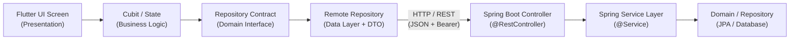

# Backend API Traceability & Mapping Specification

**Project:** Pickleball Multi-Role Platform  
**Architecture:** Flutter Clean Architecture (Presentation / Domain / Data) ↔ Spring Boot 3.x REST Services  
**Document Status:** **PROPOSED** (Awaiting backend engineering sign-off)  
**Last Updated:** 06 November 2026  
**Related Documents:**
- [`API_CONTRACT.md`](./API_CONTRACT.md) — Canonical REST API payloads, headers, error codes, and schemas.
- [`UI_BACKEND_HANDOFF.md`](./UI_BACKEND_HANDOFF.md) — Comprehensive screen-by-screen UI behavior and interaction contracts.

---

## 1. Architectural Traceability Model

Every user interaction in the Pickleball frontend flows deterministically through Clean Architecture layers before issuing network requests to proposed Spring Boot backend services:



---

## 2. Master End-to-End Traceability Matrix

The table below maps every client-side screen, trigger, and state transition to its corresponding frontend components, network boundary definitions, and proposed Spring Boot backend architecture. All endpoints are currently **PROPOSED**.

| # | Flutter Screen & Route | Presentation (Cubit / Method) | Domain Repository Method | Network Call (Method & Proposed Endpoint) | Proposed Spring Boot Controller | Proposed Spring Service | Request Model (Client / API) | Response Model (Client / API) | Status |
|---|---|---|---|---|---|---|---|---|---|
| **1** | **Welcome Screen**<br>`/welcome`<br>`WelcomePage` | *Pure Navigation*<br>(Routes to `/auth/login` or `/auth/register`) | *None* | *None (Local Client Route)* | *N/A* | *N/A* | *None* | *None* | COMPLETE (UI) |
| **2** | **Login Screen**<br>`/auth/login`<br>`LoginPage` | `LoginCubit`<br>`.submitLogin(phone, password)` | `AuthRepository`<br>`.login(phone, password)` | `POST /api/v1/auth/login` | `AuthController`<br>`.login(@Valid @RequestBody LoginRequest)` | `AuthService`<br>`.authenticateUser(phone, rawPassword)` | `LoginRequest`<br>`phone, password` | `AuthResponseModel`<br>→ `AuthSessionEntity` | PROPOSED |
| **3** | **Registration — Step 1: Form**<br>`/auth/register`<br>`RegisterPage` | `RegistrationCubit`<br>`.submitRegistration(...)` | `RegistrationRepository`<br>`.initiateRegistration(...)` | `POST /api/v1/auth/register/player` | `RegistrationController`<br>`.registerPlayer(@Valid @RequestBody ...)` | `RegistrationService`<br>`.initiatePlayerRegistration(...)` | `RegisterPlayerRequest`<br>`fullName, phone, password` | `RegistrationInitiatedModel`<br>→ `RegistrationInitiatedEntity` | PROPOSED |
| **4** | **Registration — Step 2: Verify OTP**<br>`/auth/register`<br>`RegisterPage` | `RegistrationCubit`<br>`.submitOtp(otp)` | `RegistrationRepository`<br>`.verifyOtp(...)` | `POST /api/v1/auth/register/verify-otp` | `RegistrationController`<br>`.verifyOtp(@Valid @RequestBody ...)` | `RegistrationService`<br>`.verifyRegistrationOtp(...)` | `VerifyOtpRequest`<br>`phone, otpSessionId, otpCode` | `RegistrationVerifiedModel`<br>→ `RegistrationVerifiedEntity` | PROPOSED |
| **5** | **Registration — Step 2: Resend OTP**<br>`/auth/register`<br>`RegisterPage` | `RegistrationCubit`<br>`.resendOtp()` | `RegistrationRepository`<br>`.resendOtp(...)` | `POST /api/v1/auth/register/resend-otp` | `RegistrationController`<br>`.resendOtp(@Valid @RequestBody ...)` | `RegistrationService`<br>`.resendRegistrationOtp(...)` | `ResendOtpRequest`<br>`phone, otpSessionId` | `RegistrationInitiatedModel`<br>→ `RegistrationInitiatedEntity` | PROPOSED |
| **6** | **Forgot Password — Step 1: Phone**<br>`/auth/forgot-password`<br>`ForgotPasswordPage` | `ForgotPasswordCubit`<br>`.requestOtp(phone)` | `ForgotPasswordRepository`<br>`.initiateReset(phone)` | `POST /api/v1/auth/forgot-password/initiate` | `PasswordResetController`<br>`.initiateReset(@Valid @RequestBody ...)` | `PasswordResetService`<br>`.sendResetOtp(phone)` | `ForgotPasswordInitiateRequest`<br>`phone, countryCode` | `ForgotPasswordInitiatedModel`<br>→ `ForgotPasswordInitiatedEntity` | PROPOSED |
| **7** | **Forgot Password — Step 2: Verify OTP**<br>`/auth/forgot-password`<br>`ForgotPasswordPage` | `ForgotPasswordCubit`<br>`.verifyOtp(otpCode)` | `ForgotPasswordRepository`<br>`.verifyOtp(...)` | `POST /api/v1/auth/forgot-password/verify-otp` | `PasswordResetController`<br>`.verifyResetOtp(@Valid @RequestBody ...)` | `PasswordResetService`<br>`.verifyResetOtp(...)` | `ForgotPasswordVerifyOtpRequest`<br>`phone, resetSessionId, otpCode` | `ForgotPasswordVerifiedModel`<br>→ `ForgotPasswordVerifiedEntity` | PROPOSED |
| **8** | **Forgot Password — Step 2: Resend OTP**<br>`/auth/forgot-password`<br>`ForgotPasswordPage` | `ForgotPasswordCubit`<br>`.resendOtp()` | `ForgotPasswordRepository`<br>`.resendOtp(...)` | `POST /api/v1/auth/forgot-password/resend-otp` | `PasswordResetController`<br>`.resendResetOtp(@Valid @RequestBody ...)` | `PasswordResetService`<br>`.resendResetOtp(...)` | `ForgotPasswordResendOtpRequest`<br>`phone, resetSessionId` | `ForgotPasswordInitiatedModel`<br>→ `ForgotPasswordInitiatedEntity` | PROPOSED |
| **9** | **Forgot Password — Step 3: New Password**<br>`/auth/forgot-password`<br>`ForgotPasswordPage` | `ForgotPasswordCubit`<br>`.submitNewPassword(newPassword)` | `ForgotPasswordRepository`<br>`.completeReset(...)` | `POST /api/v1/auth/forgot-password/reset` | `PasswordResetController`<br>`.completeReset(@Valid @RequestBody ...)` | `PasswordResetService`<br>`.resetPassword(...)` | `ForgotPasswordResetRequest`<br>`phone, resetSessionId, resetToken, newPassword` | `PasswordResetResultModel`<br>→ `PasswordResetResultEntity` | PROPOSED |
| **10** | **Role Selection — Fetch Roles**<br>`/role-selection`<br>`RoleSelectionPage` | `RoleSelectionCubit`<br>`.loadRoleContext(userId)` | `RoleContextRepository`<br>`.fetchRoleContext(userId)` | `GET /api/v1/auth/roles` | `UserRoleController`<br>`.getAssignedRoles(@AuthenticationPrincipal ...)` | `UserRoleService`<br>`.getUserRoleContext(userId)` | *None (Bearer Token)* | `RoleContextModel`<br>→ `RoleContext` | PROPOSED |
| **11** | **Role Selection — Save Preference**<br>`/role-selection`<br>`RoleSelectionPage` | `RoleSelectionCubit`<br>`.confirmRoleSelection(remember)` | `RoleContextRepository`<br>`.selectPreferredRole(...)` | `PUT /api/v1/users/preferences/preferred-role` | `UserPreferenceController`<br>`.setPreferredRole(@Valid @RequestBody ...)` | `UserPreferenceService`<br>`.savePreferredRole(userId, assignmentId)` | `SetPreferredRoleRequest`<br>`roleAssignmentId` | `StandardSuccessResponse`<br>`userId, roleAssignmentId, message` | PROPOSED |
| **12** | **Role Selection — Clear Preference**<br>`/role-selection`<br>`RoleSelectionPage` | `RoleSelectionCubit`<br>`.clearPreferredRole(userId)` | `RoleContextRepository`<br>`.clearPreferredRole(userId)` | `DELETE /api/v1/users/preferences/preferred-role` | `UserPreferenceController`<br>`.clearPreferredRole(@AuthenticationPrincipal ...)` | `UserPreferenceService`<br>`.clearPreferredRole(userId)` | *None (Bearer Token)* | `StandardSuccessResponse`<br>`userId, message` | PROPOSED |
| **13** | **Global Session Management**<br>App-wide Shell & Guards | `SessionCubit`<br>`.switchRole(role)`<br>`.setOrganization(orgId)` | `RolePreferenceStorage`<br>`.setPreferredAssignmentId(...)` | *Local State + Optional Preference Sync* | *N/A (Client Session)* | *N/A* | `UserRole, organizationId` | `SessionState` | COMPLETE (Client) |

---

## 3. Screen-by-Screen Detailed Mappings

### 3.1 Welcome / App Entry (`WelcomePage`)
- **Route:** `/welcome` (`AppRoutes.welcome`)
- **Flutter Widget:** `lib/features/welcome/presentation/pages/welcome_page.dart`
- **Clean Architecture Flow:** Pure UI presentation. Direct user triggers delegate to GoRouter navigation:
  - Tapping **"Sign In"** navigates to `/auth/login`.
  - Tapping **"Create Player Account"** navigates to `/auth/register`.
- **Backend API Interaction:** None. Fully client-driven.

---

### 3.2 Login Flow (`LoginPage`)
- **Route:** `/auth/login` (`AppRoutes.login`)
- **Flutter Widget:** `lib/features/auth/presentation/pages/login_page.dart`
- **Cubit:** `LoginCubit` (`lib/features/auth/presentation/cubit/login_cubit.dart`)
- **Domain Interface:** `AuthRepository.login()` (`lib/features/auth/domain/repositories/auth_repository.dart`)
- **Data Implementation:** `RemoteAuthRepository.login()` (`lib/features/auth/data/repositories/remote_auth_repository.dart`)
- **Proposed HTTP Endpoint:**
  - **Method:** `POST`
  - **Path:** `/api/v1/auth/login`
  - **Auth:** Public
  - **Request DTO:**
    ```json
    {
      "phone": "+919876543210",
      "password": "Password123"
    }
    ```
  - **Response DTO:**
    ```json
    {
      "userId": "usr_001",
      "phone": "+919876543210",
      "email": "alex.rivera@example.com",
      "displayName": "Alex Rivera",
      "token": "jwt_sample_token",
      "refreshToken": "jwt_refresh_sample",
      "roles": ["player", "coach"],
      "isSuspended": false
    }
    ```
- **Proposed Spring Boot Mapping:**
  - **Controller:** `com.pickleball.platform.auth.controller.AuthController`
  - **Method:** `public ResponseEntity<AuthResponseDTO> login(@Valid @RequestBody LoginRequestDTO request)`
  - **Service:** `com.pickleball.platform.auth.service.AuthService.authenticateUser(String phone, String password)`

---

### 3.3 Player Self-Registration & OTP Verification (`RegisterPage`)
- **Route:** `/auth/register` (`AppRoutes.register`)
- **Flutter Widget:** `lib/features/auth/presentation/pages/register_page.dart`
- **Cubit:** `RegistrationCubit` (`lib/features/auth/presentation/cubit/registration_cubit.dart`)
- **Domain Interface:** `RegistrationRepository` (`lib/features/auth/domain/repositories/registration_repository.dart`)
- **Data Implementation:** `RemoteRegistrationRepository` (`lib/features/auth/data/repositories/remote_registration_repository.dart`)

#### Sub-Flow A: Initiate Registration
- **Trigger:** Form submit with `fullName`, `phone`, `password`.
- **Proposed HTTP Endpoint:** `POST /api/v1/auth/register/player`
- **Proposed Spring Boot Controller:** `RegistrationController.registerPlayer(@Valid @RequestBody RegisterPlayerRequestDTO request)`
- **Proposed Spring Service:** `RegistrationService.initiatePlayerRegistration(RegisterPlayerCommand command)`

#### Sub-Flow B: Verify OTP
- **Trigger:** 6-digit code submit with preserved `otpSessionId`.
- **Proposed HTTP Endpoint:** `POST /api/v1/auth/register/verify-otp`
- **Proposed Spring Boot Controller:** `RegistrationController.verifyOtp(@Valid @RequestBody VerifyOtpRequestDTO request)`
- **Proposed Spring Service:** `RegistrationService.verifyRegistrationOtp(String phone, String otpSessionId, String otpCode)`

#### Sub-Flow C: Resend OTP
- **Trigger:** Resend countdown reached 0 and user taps "Resend Code".
- **Proposed HTTP Endpoint:** `POST /api/v1/auth/register/resend-otp`
- **Proposed Spring Boot Controller:** `RegistrationController.resendOtp(@Valid @RequestBody ResendOtpRequestDTO request)`
- **Proposed Spring Service:** `RegistrationService.resendRegistrationOtp(String phone, String otpSessionId)`

---

### 3.4 Forgot Password Flow (`ForgotPasswordPage`)
- **Route:** `/auth/forgot-password` (`AppRoutes.forgotPassword`)
- **Flutter Widget:** `lib/features/auth/presentation/pages/forgot_password_page.dart`
- **Cubit:** `ForgotPasswordCubit` (`lib/features/auth/presentation/cubit/forgot_password_cubit.dart`)
- **Domain Interface:** `ForgotPasswordRepository` (`lib/features/auth/domain/repositories/forgot_password_repository.dart`)
- **Data Implementation:** `RemoteForgotPasswordRepository` (`lib/features/auth/data/repositories/remote_forgot_password_repository.dart`)

#### Sub-Flow A: Request Reset OTP
- **Proposed HTTP Endpoint:** `POST /api/v1/auth/forgot-password/initiate`
- **Proposed Spring Boot Controller:** `PasswordResetController.initiateReset(@Valid @RequestBody InitiateResetRequestDTO request)`
- **Proposed Spring Service:** `PasswordResetService.sendResetOtp(String phone)`

#### Sub-Flow B: Verify Reset OTP
- **Proposed HTTP Endpoint:** `POST /api/v1/auth/forgot-password/verify-otp`
- **Proposed Spring Boot Controller:** `PasswordResetController.verifyOtp(@Valid @RequestBody VerifyResetOtpRequestDTO request)`
- **Proposed Spring Service:** `PasswordResetService.verifyResetOtp(String phone, String resetSessionId, String otpCode)`
- **Client Artifact:** Obtains verified `resetToken` for Step 3.

#### Sub-Flow C: Resend Reset OTP
- **Proposed HTTP Endpoint:** `POST /api/v1/auth/forgot-password/resend-otp`
- **Proposed Spring Boot Controller:** `PasswordResetController.resendOtp(@Valid @RequestBody ResendResetOtpRequestDTO request)`
- **Proposed Spring Service:** `PasswordResetService.resendResetOtp(String phone, String resetSessionId)`

#### Sub-Flow D: Set New Password
- **Proposed HTTP Endpoint:** `POST /api/v1/auth/forgot-password/reset`
- **Proposed Spring Boot Controller:** `PasswordResetController.completeReset(@Valid @RequestBody CompleteResetRequestDTO request)`
- **Proposed Spring Service:** `PasswordResetService.resetPassword(ResetPasswordCommand command)`

---

### 3.5 Multi-Role Selection & Routing (`RoleSelectionPage`)
- **Route:** `/role-selection` (`AppRoutes.roleSelection`)
- **Flutter Widget:** `lib/features/role_selection/presentation/pages/role_selection_page.dart`
- **Cubit:** `RoleSelectionCubit` (`lib/features/role_selection/presentation/cubit/role_selection_cubit.dart`)
- **Domain Interface:** `RoleContextRepository` (`lib/features/role_selection/domain/repositories/role_context_repository.dart`)
- **Data Implementation:** `RemoteRoleContextRepository` (`lib/features/role_selection/data/repositories/remote_role_context_repository.dart`)

#### Sub-Flow A: Fetch Role Assignments
- **Trigger:** Screen load (`loadRoleContext(userId)`).
- **Proposed HTTP Endpoint:** `GET /api/v1/auth/roles`
- **Headers:** `Authorization: Bearer <jwt_token>`
- **Response Structure:** Includes unique `roleAssignmentId` per assignment context, role string identifier, organization affiliation (`organizationId`, `organizationName`), and `isActive` status.
- **Proposed Spring Boot Controller:**
  - `UserRoleController.getAssignedRoles(@AuthenticationPrincipal UserPrincipal principal)`
- **Proposed Spring Service:**
  - `UserRoleService.getUserRoleContext(UUID userId)`

#### Sub-Flow B: Persist Preferred Role Assignment
- **Trigger:** User checks "Remember my choice" and clicks "Continue to Dashboard".
- **Proposed HTTP Endpoint:** `PUT /api/v1/users/preferences/preferred-role`
- **Headers:** `Authorization: Bearer <jwt_token>`
- **Payload:**
  ```json
  {
    "roleAssignmentId": "assign_venue_staff_001"
  }
  ```
- **Proposed Spring Boot Controller:**
  - `UserPreferenceController.setPreferredRole(@AuthenticationPrincipal UserPrincipal principal, @Valid @RequestBody SetPreferredRoleRequestDTO request)`
- **Proposed Spring Service:**
  - `UserPreferenceService.savePreferredRole(UUID userId, String roleAssignmentId)`

#### Sub-Flow C: Clear Preferred Role Assignment
- **Trigger:** Resetting preferred role on sign-out or manual preference toggle clear.
- **Proposed HTTP Endpoint:** `DELETE /api/v1/users/preferences/preferred-role`
- **Proposed Spring Boot Controller:**
  - `UserPreferenceController.clearPreferredRole(@AuthenticationPrincipal UserPrincipal principal)`
- **Proposed Spring Service:**
  - `UserPreferenceService.clearPreferredRole(UUID userId)`

---

## 4. DTO & Domain Entity Cross-Reference

| Layer | Flutter Client Class | Proposed Spring Boot DTO / Entity |
|---|---|---|
| **Auth Session** | `AuthResponseModel` → `AuthSessionEntity` | `com.pickleball.platform.auth.dto.AuthResponseDTO`<br>`com.pickleball.platform.user.entity.UserAccount` |
| **Registration Request** | `RegisterRequestModel` | `com.pickleball.platform.auth.dto.RegisterPlayerRequestDTO` |
| **Registration Session** | `RegistrationInitiatedModel` → `RegistrationInitiatedEntity` | `com.pickleball.platform.auth.dto.OtpSessionResponseDTO`<br>`com.pickleball.platform.auth.entity.OtpVerificationSession` |
| **Registration Verified** | `RegistrationVerifiedModel` → `RegistrationVerifiedEntity` | `com.pickleball.platform.auth.dto.RegistrationVerifiedDTO` |
| **Forgot Password Session** | `ForgotPasswordInitiatedModel` → `ForgotPasswordInitiatedEntity` | `com.pickleball.platform.auth.dto.PasswordResetSessionDTO` |
| **Forgot Password Verified** | `ForgotPasswordVerifiedModel` → `ForgotPasswordVerifiedEntity` | `com.pickleball.platform.auth.dto.PasswordResetVerifiedDTO` |
| **Password Reset Result** | `PasswordResetResultModel` → `PasswordResetResultEntity` | `com.pickleball.platform.auth.dto.PasswordResetSuccessDTO` |
| **Role Assignment Context** | `RoleProfileModel` → `RoleProfile` | `com.pickleball.platform.role.dto.RoleAssignmentDTO`<br>`com.pickleball.platform.role.entity.UserRoleAssignment` |
| **User Role Context** | `RoleContextModel` → `RoleContext` | `com.pickleball.platform.role.dto.UserRoleContextResponseDTO` |

---

## 5. Summary of Invariants & Business Safeguards

1. **Organization-Scoped Same-Role Disambiguation:**
   - Multiple assignments of the identical `UserRole` (e.g. `venueStaff` at Arena A and Arena B) are distinguished by `roleAssignmentId`.
   - Selections update `SessionCubit.switchRole(profile.role)` AND `SessionCubit.setOrganization(profile.organizationId)`.

2. **Safe Role Parsing Invariant:**
   - Client parser `RoleProfileModel.fromJson()` strictly rejects records missing `role` or `isActive`.
   - The platform never grants fallback `player` roles when parsing empty, incomplete, or malformed role data.

3. **Status Clarity:**
   - All REST endpoints documented in this mapping remain **PROPOSED** pending backend team review and implementation.
   - Flutter remote repositories currently return structured `FailureResult` placeholders with explicit service-unavailable messaging without throwing unhandled exceptions.
